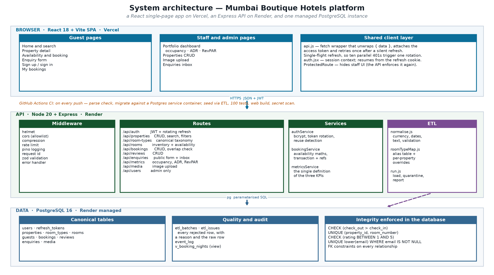
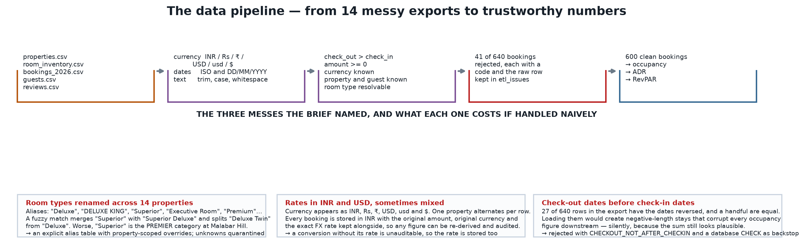

# Mumbai Boutique Hotels — Full-Stack Booking & Enquiry Platform

A complete hotel booking and enquiry platform for a fictional group of **14 boutique properties across Mumbai**,
built for the Junior Full Stack Developer internship project track.

**Stack:** React 18 + Vite · Node 20 + Express · PostgreSQL 16 · JWT with rotating refresh tokens ·
GitHub Actions CI · deployed to GitHub Pages, with configuration for Netlify, Render and Vercel.

## Live site

### **https://rabinarayanpatra350-biotech.github.io/hotel-platform/**

A working build, reading the same live PostgreSQL database as the full application — browse all 14 properties,
open one to see room types, real inventory and guest reviews, submit a booking or an enquiry, and open the
staff dashboard for occupancy, ADR and RevPAR.

GitHub Pages is static, so this build talks to the database through Supabase's REST API instead of the Express
server. That means **no sign-in and no staff/admin roles** here; the complete server-side application, with JWT
sessions, rotating refresh tokens and role-based access, is in [`/server`](server/) and covered by 125 passing
tests. See [DEPLOYMENT.md](DEPLOYMENT.md) for the full picture.

---

## Contents

- [What this is](#what-this-is)
- [Quick start](#quick-start)
- [The data problem](#the-data-problem-this-is-the-interesting-part)
- [Architecture](#architecture)
- [API](#api)
- [Auth and roles](#auth-and-roles)
- [The three metrics](#the-three-metrics)
- [Testing](#testing)
- [Deployment](#deployment)
- [Design decisions worth defending](#design-decisions-worth-defending)
- [Project layout](#project-layout)

---

## What this is

A guest-facing website and a staff back office, sharing one API:

**Guests** can search 14 properties with filters, view room types and live availability for their dates,
book without creating an account, send an enquiry, sign up, and see their own bookings.

**Staff** get a portfolio dashboard showing **occupancy, ADR and RevPAR** per property and per month,
plus property CRUD with image upload and an enquiries inbox.

**Admins** additionally manage users and delete records.

---

## Quick start

Requires Node 20+. No Docker and no system PostgreSQL needed for local development.

```bash
git clone <this-repo> && cd hotel-platform

# ---------------------------------------------------------------- API
cd server
npm ci
cp ../.env.example .env            # then edit if you like; the defaults work

# Start a throwaway PostgreSQL and print its connection string.
# Paste that into DATABASE_URL in .env.
npm run db:local                   # prints postgres://postgres@127.0.0.1:55432/hotel
# (Ctrl+C stops it; leave it running in a second terminal)

npm run migrate                    # create the schema
npm run seed                       # load the 14 properties' raw exports through the ETL
npm run dev                        # API on http://localhost:4000

# ---------------------------------------------------------------- web
cd ../web
npm ci
npm run dev                        # site on http://localhost:5173
```

Create your first admin (public sign-up only ever creates guests, by design):

```bash
cd server
node -e "
const bcrypt=require('bcryptjs');
import('./src/db/pool.js').then(async ({query})=>{
  await query(\"INSERT INTO users (email,password_hash,full_name,role) VALUES ('admin@example.com',\$1,'Admin','admin')\",
    [await bcrypt.hash('Password12345',10)]);
  console.log('admin@example.com / Password12345'); process.exit(0);
});"
```

### Environment

Everything is environment-driven; nothing is hard-coded. See `.env.example` for the full list. The
important ones:

| Variable | Purpose |
|---|---|
| `DATABASE_URL` | PostgreSQL connection string (managed instance in production) |
| `JWT_ACCESS_SECRET` / `JWT_REFRESH_SECRET` | Token signing. **Must be ≥ 32 chars in production — the app refuses to boot otherwise** |
| `CORS_ORIGINS` | Comma-separated allowlist of browser origins. Never `*` in production |
| `FX_USD_INR` | Fallback USD→INR rate used only when a source row carries no explicit rate |

---

## The data problem (this is the interesting part)

The brief specifies data from 14 properties with three named kinds of mess. Rather than clean it by hand, the
project includes an **ETL pipeline** that does it repeatably and reports what it did:

```bash
cd server && npm run seed      # or: npm run etl
```

It prints a data-quality report:

```
  ENTITY        READ    LOADED   QUARANTINED   WARNINGS
  properties       14        14             0          0
  rooms           640       640             0          0
  guests          275       225             0         17
  bookings        640       600            41         12
  reviews         300       300             0          0

  Bookings loaded cleanly: 600/640 (93.8%)
  Currency mix on loaded rows: INR 487, USD 113

  ISSUES BY CODE
  MISSING_EMAIL                     33
  CHECKOUT_NOT_AFTER_CHECKIN        27
  NEGATIVE_RATE                     14
  UNMATCHED_ROOM                    12
```

### The three messes, and what each one costs if handled naively

**1. Room types renamed across properties.** The exports contain `Deluxe`, `DELUXE KING`, `Deluxe Twin`,
`Superior`, `Executive Room`, `Premium`, `STD`, `Classic Room`, `Junior Suite`, `Quad Room`… A fuzzy match
merges `Superior` with `Superior Deluxe` and splits `Deluxe Twin` from `Deluxe`. Worse: **`Superior` is the
premier category at Malabar Hill**, whose own rate card says so. The mapping is therefore an explicit alias
table in [`server/src/etl/roomTypeMap.js`](server/src/etl/roomTypeMap.js) with **property-scoped overrides**,
and anything unrecognised is **quarantined rather than guessed**.

**2. Rates in INR and USD, sometimes mixed within one property.** Currency appears as `INR`, `Rs`, `₹`, `USD`,
`usd` and `$`, and one property alternates per row. Every booking is stored in INR in `rate_inr`, with
`amount_original`, `currency_original` and `fx_rate` kept alongside — so **any converted figure can be
re-derived and audited**. A conversion without its rate is unauditable, which is why the rate is stored.

**3. Check-out before check-in.** 27 of 640 rows have the dates reversed. Loading them creates
negative-length stays that corrupt every occupancy figure downstream — silently, because the sum still looks
plausible. They are rejected with `CHECKOUT_NOT_AFTER_CHECKIN`, and there is a database `CHECK` constraint as
a backstop in case anything ever bypasses the ETL.

Nothing is silently dropped: every rejected row is written to `etl_issues` with its row number, a reason code
and the original row, so a human can review the decision later. See [docs/data-quality.md](docs/data-quality.md).

---

## Architecture



Three tiers, one database. The browser never talks to Postgres; the API never trusts the browser.

```
React SPA (Vercel)  ──HTTPS/JSON + JWT──▶  Express API (Render)  ──pg/SQL──▶  PostgreSQL 16 (Render)
```

The data path, end to end:



---

## API

Full OpenAPI 3.1 specification: **[docs/openapi.yaml](docs/openapi.yaml)**.
Browse it at `GET /api/docs` once the API is running.

| Method | Path | Access | Notes |
|---|---|---|---|
| `GET` | `/api/health` | public | DB liveness + uptime |
| `POST` | `/api/auth/signup` | public | always creates a **guest** |
| `POST` | `/api/auth/login` | public | returns access + refresh token |
| `POST` | `/api/auth/refresh` | public | rotates; detects reuse |
| `POST` | `/api/auth/logout` | public | revokes the presented refresh token |
| `GET` | `/api/auth/me` | auth | current user |
| `GET` | `/api/properties` | public | `q`, `city`, `minStar`, `sort`, `order`, paging |
| `GET` | `/api/properties/:id` | public | includes room types and review summary |
| `POST` `PATCH` | `/api/properties[/:id]` | staff | create / update |
| `DELETE` | `/api/properties/:id` | **admin** | |
| `GET` | `/api/room-types` | public | the canonical taxonomy |
| `GET` | `/api/rooms/availability` | public | free rooms per type for a date range |
| `GET` `POST` `PATCH` `DELETE` | `/api/bookings[/:id]` | mixed | guests see only their own |
| `GET` `POST` | `/api/reviews` | public | |
| `POST` | `/api/enquiries` | public | the website's enquiry form |
| `GET` `PATCH` | `/api/enquiries[/:id]` | staff | inbox |
| `GET` | `/api/metrics` | staff | occupancy, ADR, RevPAR |
| `GET` | `/api/metrics/occupancy-series` | staff | per-night series for charts |
| `POST` | `/api/media` | staff | image upload, multipart |
| `GET` `POST` `PATCH` | `/api/users` | **admin** | user administration |
| `GET` | `/api/jobs` | staff | queue depth by status + recent jobs |
| `GET` | `/api/jobs/emails` | staff | the email log — every send, with its outcome |

Every response is either `{ "data": … }` or `{ "error": { "code", "message", "details" } }` — one shape,
never a guess.

```bash
# Public: what is free, and what it costs
curl "http://localhost:4000/api/properties?minStar=5&q=Juhu"

# Book without an account
curl -X POST http://localhost:4000/api/bookings -H 'Content-Type: application/json' -d '{
  "propertyId":"<uuid>","checkIn":"2027-06-01","checkOut":"2027-06-04",
  "guest":{"fullName":"Asha Rao","email":"asha@example.com"}}'

# Staff: the dashboard numbers
curl "http://localhost:4000/api/metrics?from=2026-01-01&to=2026-04-01" \
  -H "Authorization: Bearer $TOKEN"
```

---

## Auth and roles

- **Access token** — a JWT, 15 minutes, sent as `Authorization: Bearer …`.
- **Refresh token** — opaque random bytes, 30 days, in an `httpOnly` cookie (also returned in the body for
  non-browser clients). Stored **hashed** in the database.
- **Rotation with reuse detection.** Every refresh burns the presented token and issues a new one in the same
  family. Presenting a burned token means two parties hold it, so **the entire family is revoked** and both
  are forced to sign in again.

Roles are `guest` < `staff` < `admin`. Public sign-up only ever creates a guest; staff and admin accounts are
created by an admin via `POST /api/users`. Otherwise the first person to register would own the system.

**The UI hides what a role cannot do, and the API enforces it again.** The route guard is a convenience, not a
security boundary — anyone can edit the bundle or call the endpoint directly, and the tests check that the API
refuses them.

---

## The three metrics

Defined once, in [`server/src/services/metricsService.js`](server/src/services/metricsService.js), and used by
the dashboard, the tests and the report — so they cannot drift apart.

| Metric | Definition |
|---|---|
| **Occupancy** | room-nights sold ÷ room-nights available |
| **ADR** | room revenue ÷ room-nights sold |
| **RevPAR** | room revenue ÷ room-nights available (= ADR × occupancy) |

Two decisions change the numbers and are therefore stated explicitly:

1. **Cancelled bookings are excluded everywhere.** A cancelled booking is not revenue and does not occupy a room.
2. **A stay that straddles the window contributes only the nights inside it**, with its total rate apportioned
   per night. A 5-night booking overlapping the window by 2 nights adds 2/5 of its rate — not all of it.

The metrics test builds a 10-room property with a known set of bookings and asserts the three figures against
values worked out by hand.

---

## Email notifications and the background job queue

The brief's stretch requirement. Both are implemented, and the reason they exist together is that sending an
email is a **network call to somebody else's server**: done inline in a request, a slow SMTP host becomes a slow
booking and an SMTP outage becomes a failed booking — for a booking that was already committed.

### The queue

A job queue built on **PostgreSQL**, not Redis, using `FOR UPDATE SKIP LOCKED`:

```sql
UPDATE jobs SET status = 'running', locked_at = now(), locked_by = $1, attempts = attempts + 1
WHERE id = (
  SELECT id FROM jobs WHERE status = 'pending' AND run_at <= now()
  ORDER BY run_at, created_at
  FOR UPDATE SKIP LOCKED LIMIT 1
)
RETURNING *
```

`SKIP LOCKED` is the whole trick: concurrent workers step over rows another worker holds instead of blocking
behind them, so throughput scales with workers rather than serialising behind one. Adding Redis to a deployment
that already has Postgres would add a moving part and a failure mode for no capability we do not already have at
this scale.

What the queue does:

- **Enqueued in the same transaction as the business event.** A booking and its confirmation email are written
  together, so if the booking rolls back no email survives to tell a guest about a stay that does not exist.
- **Retries with exponential backoff and jitter** — jitter matters, because a hundred jobs that failed at the
  same instant would otherwise all retry at the same instant and recreate the outage that caused them to fail.
- **Gives up after `max_attempts`** and records the final error, rather than retrying forever.
- **Reclaims abandoned jobs.** A worker that dies mid-job leaves its row in `running`; anything locked longer
  than the visibility timeout is treated as abandoned and re-queued.
- **Deduplicates.** A `dedupe_key` makes enqueueing idempotent, so a retried request cannot send two emails.

### The emails

Three notifications, each queued rather than sent inline:

| Trigger | Recipient | Template |
|---|---|---|
| Booking created | The guest | `booking_confirmation` — reference, dates, rooms, total |
| Booking created | The front desk | `staff_booking_alert` — guest contact, dates, source |
| Enquiry submitted | The enquirer | `enquiry_acknowledgement` — quotes their message back |

Three transports, chosen by configuration and never by a code change: `console` (development — prints the email
to the log), `record` (tests — sends nothing), and `smtp` (production, via nodemailer). Every attempt is written
to `email_log` whatever the outcome, so *"we told this guest"* is a queryable fact rather than an assumption.

Templates are plain functions with **every interpolated value escaped** — a guest's name is user input, and an
email body is a place where an unescaped name becomes HTML injection.

### Running it

```bash
cd server
npm run worker        # the worker loop, in its own process
# or, for both together:
npm run dev:all
```

The queue is visible to staff at `GET /api/jobs` and the email log at `GET /api/jobs/emails` — because a
background queue nobody can see is a queue nobody can debug. When a guest says the confirmation never arrived,
the first question is whether the job ran, and that endpoint answers it.

## Testing

```bash
cd server
npm test              # 125 tests
npm run test:coverage # with a coverage report
```

**125 tests across 9 files**, all passing:

| File | Tests | Covers |
|---|---|---|
| `tests/unit/normalise.test.js` | 35 | currency, FX, dates (ISO vs DD/MM/YYYY), text, row validation |
| `tests/unit/roomTypeMap.test.js` | 8 | aliases, property overrides, refusal to guess |
| `tests/api/auth.test.js` | 15 | signup, login, token rotation, reuse detection, logout |
| `tests/api/rbac.test.js` | 7 | guest / staff / admin boundaries |
| `tests/api/properties.test.js` | 12 | CRUD, filters, sorting, injection safety |
| `tests/api/bookings.test.js` | 13 | public booking, validation, overbooking, back-to-back stays |
| `tests/api/metrics.test.js` | 10 | occupancy / ADR / RevPAR against hand-computed values |
| `tests/api/jobs.test.js` | 19 | enqueue, claim, **ten workers never claim the same job**, retry/backoff, exhaustion, dedupe, stale reclaim, worker dispatch, and end-to-end email delivery |
| `tests/unit/emailTemplates.test.js` | 6 | subject/body content, Indian money formatting, HTML escaping |

The API tests run against a **real PostgreSQL** instance — the suite starts one, applies the real schema and
seeds it through the real ETL, so they test the code that ships rather than a fixture that could drift.

Three bugs were found by these tests and fixed: a rate-revenue double-count in the metrics, a refresh-token
family revocation that rolled back with its own transaction, and an amount parser that read an unparseable
value as zero.

---

## Deployment

**Full deployment guide: [DEPLOYMENT.md](DEPLOYMENT.md).**

Both halves are configured and environment-driven.

**API → Render.** `render.yaml` is a blueprint that creates the web service and a managed Postgres together:

1. Push this repository to GitHub.
2. In Render: **New → Blueprint**, point at the repository.
3. Set `CORS_ORIGINS` to your Vercel URL and `UPLOAD_PUBLIC_BASE_URL` to the Render URL + `/uploads`.
4. `JWT_ACCESS_SECRET` and `JWT_REFRESH_SECRET` are generated automatically by the blueprint.

**Web → Vercel.** `web/vercel.json` sets the build, SPA rewrites and cache headers:

1. In Vercel: **New Project**, root directory `web`.
2. Set `VITE_API_URL` to the Render API URL.
3. Deploy.

> **Live database.** A managed Supabase PostgreSQL 17 instance is provisioned and seeded with the full
> dataset (14 properties, 640 rooms, 600 bookings, 300 reviews, 225 guests), verified by running the
> application's own occupancy/ADR/RevPAR query against it. See [DEPLOYMENT.md](DEPLOYMENT.md).

> **A note on live URLs.** The deployment configuration above is complete and ready to use, but the live
> instances must be created under the owner's own Render and Vercel accounts — deployment credentials are not
> something a repository can carry. The application has been verified running end to end locally against real
> PostgreSQL: every route exercised, 125 tests passing, and the frontend building to 60 kB gzipped.

---

## Design decisions worth defending

**Availability is a counting problem, not a lookup.** A room type is available if, for *every* night of the
requested stay, rooms already sold are fewer than rooms that exist. Overlap uses the half-open interval
`[check_in, check_out)`, so a guest leaving on the 10th frees the room for a guest arriving on the 10th. There
is a test for exactly that.

**Money is stored in one currency with its conversion preserved.** Aggregating across 14 properties that quote
in two currencies is impossible unless everything is in one unit — but silently converting destroys the audit
trail. Both are kept.

**Sort columns are whitelisted, never interpolated.** `?sort=name;DROP TABLE users` returns 422 because the
value is checked against an enum, not concatenated into SQL. There is a test for that too.

**Validation is written once and run twice.** The zod schemas in `server/src/schemas.js` are the single source
of truth; the React forms mirror the same rules so the user sees the problem before the round trip, and the
server enforces them again because the browser cannot be trusted.

**Uploaded filenames are generated, never accepted.** A client-supplied filename is a path-traversal and an XSS
vector; the original name is kept only as metadata.

**The database enforces the invariants too.** `CHECK (check_out > check_in)`, `UNIQUE (property_id,
room_number)`, `UNIQUE lower(email) WHERE email IS NOT NULL`. Application code has bugs; constraints do not.

---

## Project layout

```
hotel-platform/
├── .github/workflows/ci.yml      # parse → migrate → seed → 125 tests → build → secret scan
├── .env.example
├── render.yaml                   # API + Postgres blueprint
├── docs/
│   ├── architecture.md
│   ├── data-quality.md
│   ├── openapi.yaml              # OpenAPI 3.1
│   └── diagrams/                 # architecture.png, data-pipeline.png
├── server/
│   ├── src/
│   │   ├── app.js                # middleware chain
│   │   ├── server.js             # boot + graceful shutdown
│   │   ├── schemas.js            # zod, shared with the forms
│   │   ├── config/               # env, validated and frozen at boot
│   │   ├── db/                   # pool, migrations, schema.sql
│   │   ├── lib/                  # errors, logger, tokens, validation
│   │   ├── middleware/auth.js    # requireAuth, requireRole, optionalAuth
│   │   ├── routes/               # one file per resource
│   │   ├── services/             # auth, booking, metrics
│   │   ├── jobs/                  # queue, worker, handler registry
│   │   ├── lib/mailer.js          # console / record / smtp transports
│   │   ├── lib/emailTemplates.js  # escaped, plain-function templates
│   │   └── etl/                  # normalise, roomTypeMap, run
│   ├── data/raw/                 # the 14 properties' exports
│   ├── scripts/                  # raw-data generator, dev database
│   └── tests/                    # 100 tests
└── web/
    ├── src/
    │   ├── lib/api.js            # fetch wrapper + silent refresh
    │   ├── lib/auth.jsx          # session context
    │   ├── components/           # Nav, Footer, ProtectedRoute
    │   └── pages/                # Home, PropertyDetail, Dashboard, Admin…
    └── vercel.json
```

---

## Scaling the weakest part of the design

If asked, the honest answer is **the availability check**, not the API tier.

`assertAvailable` counts rooms and bookings for the requested nights on every booking. It is correct, and at
14 properties it is fast. It does not survive a busy Friday night at scale: two concurrent requests for the
last room both read "1 free" and both insert, because nothing locks the inventory across the read and the
write.

The fix is a reservation hold with a database-level guarantee — either a `SELECT … FOR UPDATE` on a
per-room-type-per-night inventory row, or an exclusion constraint on a `daterange` column — plus a short-lived
hold so an abandoned checkout does not block the room. That turns the check into a genuine reservation rather
than a hopeful one. It is deliberately not implemented here because it is a different piece of work, and
pretending otherwise would be worse than naming it.

---

## Licence

Portfolio project. Not affiliated with any real hotel group; all properties, guests and bookings are synthetic.
