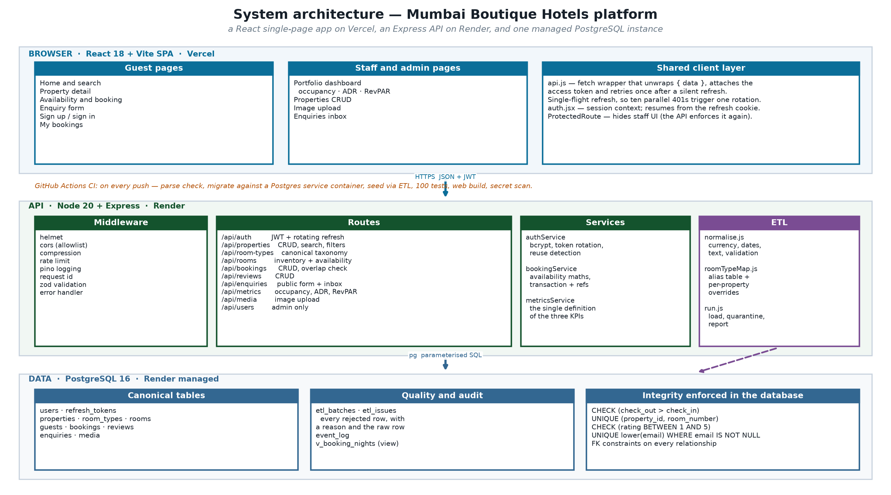

# Architecture



## The shape

Three tiers, one database. The browser never talks to PostgreSQL; the API never trusts the browser.

```
React SPA (Vercel)  ──HTTPS / JSON + JWT──▶  Express API (Render)  ──pg / SQL──▶  PostgreSQL 16 (Render)
```

## Tier 1 — the browser

A React 18 single-page app built with Vite. Five things matter about how it is put together:

- **`lib/api.js`** is the only place that calls `fetch`. It attaches the access token, unwraps the
  `{ data }` envelope and retries once after a silent refresh on a 401. The refresh is **single-flight**: ten
  requests failing at once trigger one rotation, not ten, because ten rotations would invalidate each other.
- **`lib/auth.jsx`** holds the session. On first paint it tries to resume from the refresh cookie, so a page
  reload feels like a reload rather than a logout.
- **`ProtectedRoute`** hides staff UI. It is a convenience, not a boundary — the API enforces every rule again.
- **Validation is not duplicated.** The forms mirror the zod rules so the user sees a problem before the round
  trip, and the server enforces them again because the browser cannot be trusted.
- **The bundle is 60 kB gzipped**, which is what keeps the key pages inside the two-second budget.

## Tier 2 — the API

Node 20 and Express, layered strictly:

```
request
  → helmet, cors allowlist, compression, cookie parser
  → request id
  → pino structured logging (secrets redacted by path)
  → rate limit
  → zod validation per route
  → auth middleware (requireAuth / optionalAuth / requireRole)
  → route handler
  → error middleware (one JSON error shape for the whole API)
```

- **`config/index.js`** reads the environment once, validates it, and freezes it. In production it **refuses to
  boot** without ≥32-character JWT secrets, a `DATABASE_URL`, or with a `*` CORS origin. A weak signing key is
  a silent total compromise, so it fails at boot instead.
- **`lib/errors.js`** defines `ApiError` and the single error shape. Handlers throw; one middleware converts.
  Postgres error codes are translated (`23505` → 409, `23503`/`23514` → 400).
- **`services/`** holds the logic that is worth testing on its own: auth (rotation and reuse detection),
  booking (availability and transactions), metrics (the three KPIs).
- **`etl/`** is a self-contained pipeline; see [data-quality.md](data-quality.md).

## Tier 3 — the database

PostgreSQL 16. The schema (`server/src/db/schema.sql`) is idempotent and applied by `npm run migrate`.

Invariants are enforced **in the database as well as the API**, because application code has bugs and
constraints do not:

```sql
CHECK (check_out > check_in)                      -- no negative-length stays, ever
CHECK (rating BETWEEN 1 AND 5)
UNIQUE (property_id, room_number)
UNIQUE (lower(email)) WHERE email IS NOT NULL     -- one guest per email, case-insensitively
```

Two tables exist only for trust: `etl_batches`/`etl_issues` (what was rejected and why) and `event_log`
(business events worth keeping).

## Request lifecycle for a booking

1. The guest picks dates; the browser calls `GET /api/rooms/availability`.
2. The API counts, per room type, the minimum free rooms across every night of the stay.
3. The guest submits `POST /api/bookings`.
4. Validation runs (dates ordered, guest present or resolvable, amounts sane).
5. If a room was chosen, `assertAvailable` re-checks inventory under the same rules.
6. A transaction creates the guest if new, resolves the rate from the room type if absent, generates a
   reference and inserts the booking.
7. The response carries the reference; the confirmation shows it.

## CI

`.github/workflows/ci.yml` runs on every push and pull request:

```
parse check → migrate against a Postgres service container → seed via the ETL → 100 tests → web build → secret scan
```

The API job tests against a **real PostgreSQL service container**, not a mock, so the SQL that runs in CI is
the SQL that runs in production.

## Known limit

The weakest point is the availability check, and it is named rather than hidden. `assertAvailable` reads
inventory and then inserts in the same transaction, but without a lock on a per-night inventory row two
concurrent requests for the last room can both read "1 free". At 14 properties this does not bite. The fix is a
reservation hold with a database-level guarantee (`SELECT … FOR UPDATE` on an inventory row, or an exclusion
constraint on a `daterange`), and it is deliberately left as the next piece of work.
